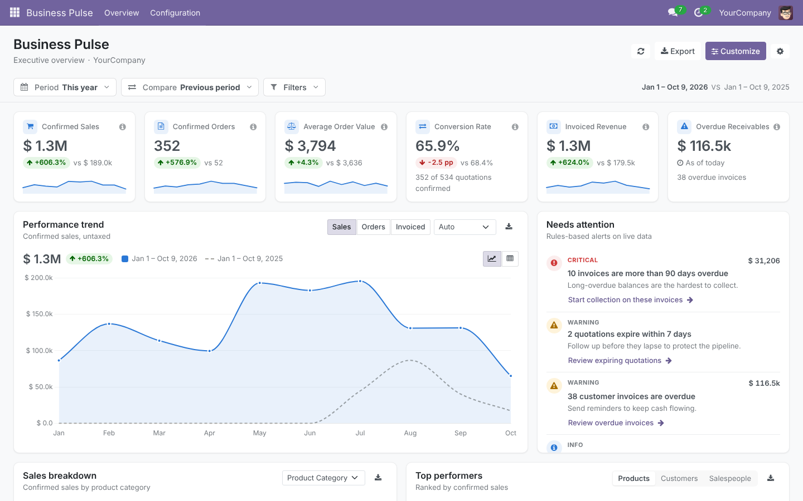

# Business Pulse for Odoo

Executive BI dashboard for **Odoo 18.0**: sales KPIs, invoiced revenue, receivables aging, period comparisons, rules-based alerts, drill-down to source records and CSV export.



## Repository layout (Odoo Apps Store)

```
business_pulse/        ← the app (one folder per app at the repository root)
README.md              ← this file
```

Module documentation, metric definitions and the security model are in [`business_pulse/README.rst`](business_pulse/README.rst).

## Publishing on apps.odoo.com

The Odoo Apps Store reads modules from a branch whose name **exactly matches the Odoo series**:

1. Create a branch named `18.0` from the reviewed code and push it.
2. On apps.odoo.com → *Upload / Register a repository*, enter the URL with the branch suffix:
   `ssh://git@github.com/<owner>/<repo>.git#18.0`
3. Before submitting, check `business_pulse/__manifest__.py`: `price`, `currency`, `author`, and add `website`/`support` contact details.

For a future Odoo 19 port, create a separate `19.0` branch with the ported code.

## Run the tests

```bash
odoo-bin -d <db> -i business_pulse --test-tags=/business_pulse --stop-after-init
```

## License

OPL-1 (Odoo Proprietary License v1.0). See [`business_pulse/LICENSE`](business_pulse/LICENSE).
